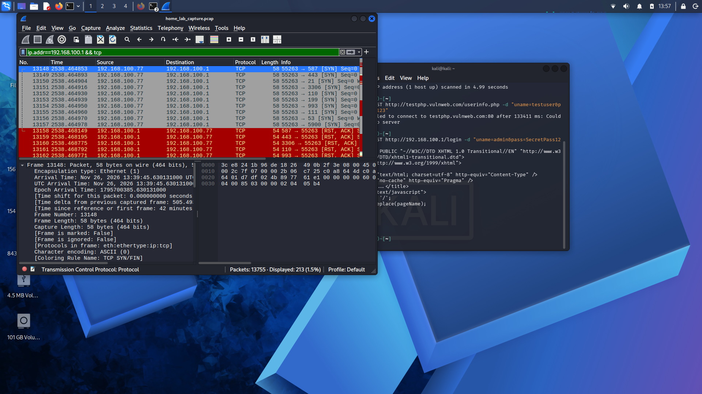
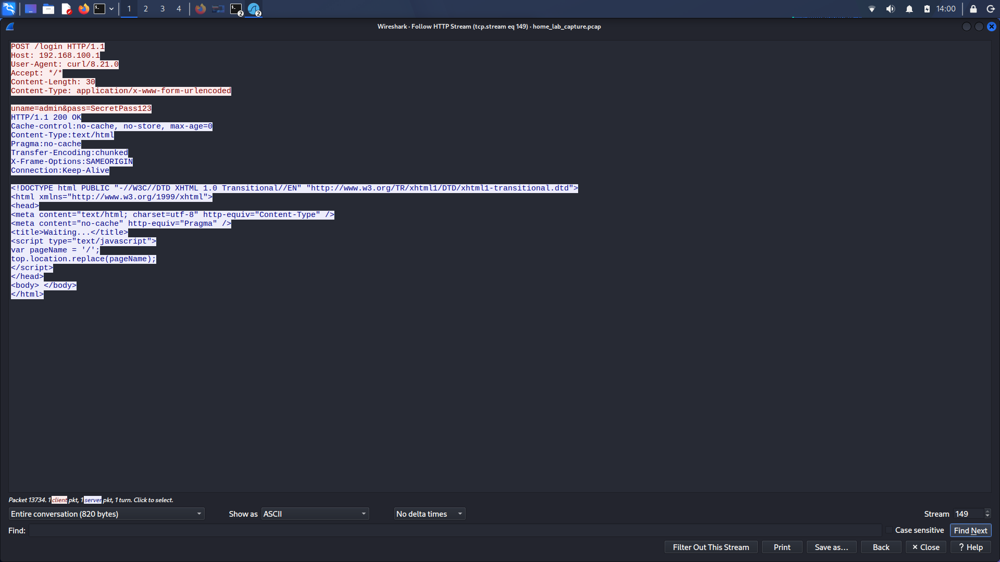

# SOC Tier 1 Network Traffic Triage & Packet Analysis

soc-l1-network-triage/
├── README.md
├── logs/
│   ├── dns_queries.log
│   └── http_requests.log
├── pcap/
│   └── home_lab_capture.pcap
└── screenshots/
    ├── Screenshot_2026-11-26_13_57_06.png
    └── Screenshot_2026-11-26_14_00_54.png

## Executive Summary
This project demonstrates Tier 1 Security Operations Center (SOC) network traffic capture, protocol filtering, log extraction, and incident documentation on Kali Linux. Using tcpdump, Wireshark, and tshark, I captured 13,755 packets over interface wlan0 (192.168.100.77/24) and triaged two simulated security alerts: an internal TCP SYN port scan and unencrypted HTTP credential transmission.

## Lab Environment & Repository Structure
* OS / Platform: Kali Linux Live (USB Persistence)
* Capture Interface: wlan0 (192.168.100.77)
* Target Gateway: 192.168.100.1
* Tools Used: tcpdump, nmap, curl, Wireshark, tshark

## Investigation Findings

### Finding 1: Internal TCP SYN Port Scan (Reconnaissance)
* Timestamp: 2026-11-26 13:39:45 UTC (Frames 13148-13162)
* Source IP: 192.168.100.77
* Destination IP: 192.168.100.1
* MITRE ATT&CK: T1046 - Network Service Discovery
* Wireshark Filter: ip.addr==192.168.100.1 && tcp
* Analysis: Isolated 213 TCP packets (1.5% of total capture) showing rapid sequential [SYN] probes from ephemeral port 55263 across multiple service ports (21, 23, 53, 80, 110, 443, 587, 3306, 5900), followed by [RST, ACK] responses on closed ports and open services on 23/tcp (Telnet), 53/tcp (DNS), and 80/tcp (HTTP).

### Finding 2: Cleartext HTTP Credential Exposure
* Timestamp: 2026-11-26 13:49:29 UTC
* Source IP: 192.168.100.77
* Destination IP: 192.168.100.1:80
* MITRE ATT&CK: T1552 - Unsecured Credentials (Cleartext Network Traffic)
* Wireshark Filter: http.request.method == "POST"
* Analysis: Detected an unencrypted HTTP POST /login request sent via curl/8.21.0. Following the TCP stream exposed plaintext form parameters (uname=admin&pass=SecretPass123) transmitted without TLS encryption.

## Remediation Recommendations (Tier 1 Escalation Notes)
1. Disable Cleartext Management Protocols: Disable Telnet (23/tcp) and HTTP (80/tcp) on gateway 192.168.100.1, enforcing SSH and HTTPS (TLS 1.2+) for administrative access.
2. Host Isolation & Triage: Investigate source host 192.168.100.77 for unauthorized scanning utilities (nmap) and verify whether the activity was authorized.
3. Credential Rotation: Immediately rotate the exposed admin account password observed in the HTTP POST payload.
